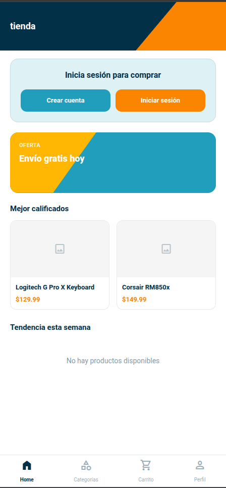
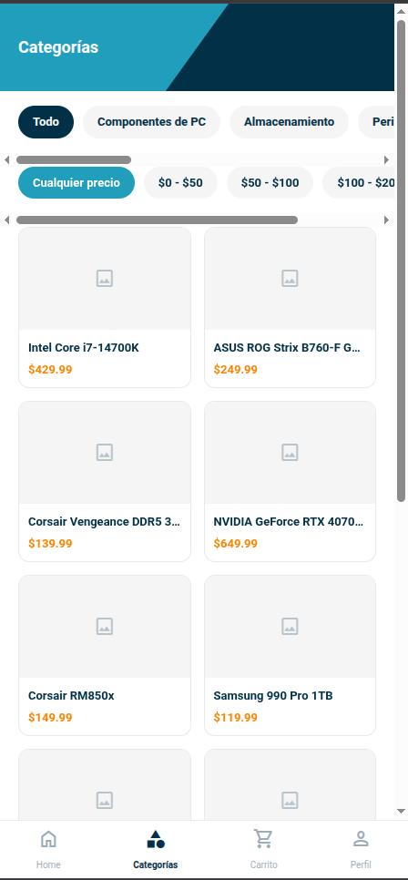
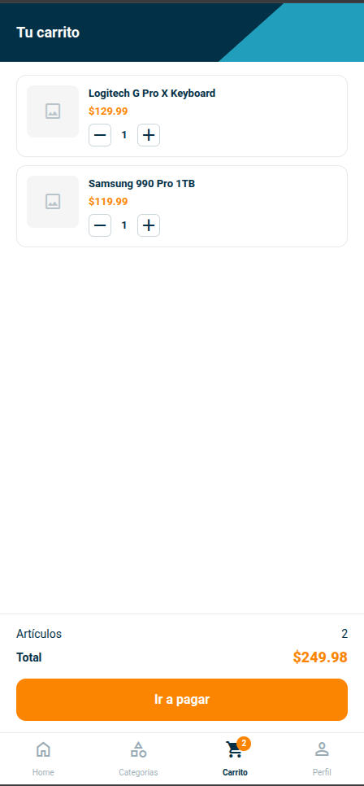
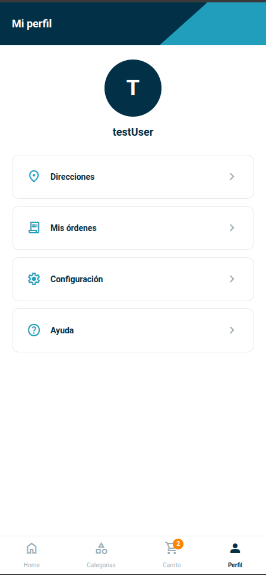
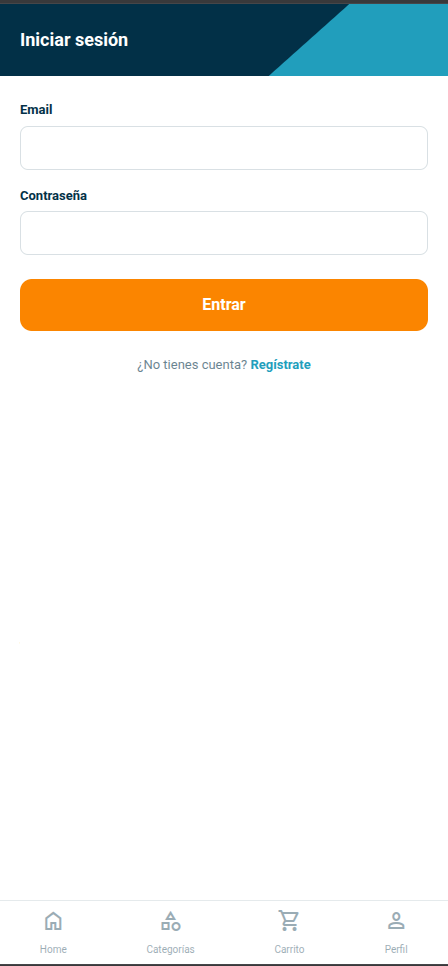

# Tienda — E-commerce full-stack

API REST para una tienda en línea, construida con **Spring Boot**, y un frontend **mobile-first** en **React + TypeScript** que la consume.

La API cubre el flujo completo de una compra: registro e inicio de sesión, catálogo con filtros y paginación, carrito, órdenes, pagos, direcciones de envío y reseñas de productos.

> **Catálogo personalizable.** La demo usa componentes de PC como productos de ejemplo, pero las categorías y los productos se administran desde la propia API. La tienda se puede adaptar a cualquier tipo de producto según las necesidades del negocio: ropa, alimentos, libros, artículos para el hogar, etc.

---

## Contenido

- [Funcionalidades](#funcionalidades)
- [Stack tecnológico](#stack-tecnológico)
- [Estructura del repositorio](#estructura-del-repositorio)
- [Backend: la API](#backend-la-api)
  - [Reglas de negocio](#reglas-de-negocio)
  - [Modelo de datos](#modelo-de-datos)
  - [Formato de respuestas](#formato-de-respuestas)
  - [Endpoints](#endpoints)
- [Frontend](#frontend)
- [Cómo ejecutar el proyecto](#cómo-ejecutar-el-proyecto)
- [CI/CD](#cicd)
- [Próximos pasos](#próximos-pasos)

---

## Funcionalidades

**Para clientes**
- Registro e inicio de sesión con JWT
- Catálogo con filtros combinables (categoría, rango de precio, nombre) y paginación
- Secciones de productos mejor calificados y en tendencia (más vendidos en las últimas 48 horas)
- Carrito persistente en el navegador
- Checkout con selección de dirección y método de pago
- Historial de órdenes con detalle y cancelación de órdenes pendientes
- Reseñas con calificación de 1 a 5 estrellas (solo de productos comprados)
- Gestión de direcciones de envío

**Para administradores**
- Creación de categorías y productos
- Listado de usuarios, búsqueda por rol y cambio de rol
- Super administrador creado automáticamente al iniciar la base de datos

---

## Stack tecnológico

| Capa | Tecnologías |
|---|---|
| **Backend** | Java 21, Spring Boot 4, Spring Security, JWT (jjwt), Spring Data JPA, Bean Validation, Lombok |
| **Base de datos** | PostgreSQL 16, Flyway (migraciones versionadas) |
| **Frontend** | React 19, TypeScript, Vite, Tailwind CSS v4, React Router, Axios |
| **UI** | Roboto, Material Symbols |
| **Infraestructura** | Docker, Docker Compose, GitHub Actions, Docker Hub |

---

## Estructura del repositorio

```
EcommercePractica/
├── Ecommerse/              # Backend (Spring Boot)
│   ├── src/main/java/org/example/ecommerse/
│   │   ├── controllers/
│   │   ├── domains/        # Entidades y DTOs
│   │   ├── exceptions/     # Excepciones y GlobalExceptionHandler
│   │   ├── helpers/        # Enums y mappers
│   │   ├── repositories/
│   │   ├── security/       # JWT, filtro y configuración de seguridad
│   │   └── services/       # Lógica de negocio, organizada por módulo
│   ├── src/main/resources/
│   │   ├── db/migration/   # Migraciones de Flyway
│   │   ├── application.yml
│   │   ├── application-local.yml
│   │   └── application-docker.yml
│   └── Dockerfile
├── frontend/               # Frontend (React + Vite)
├── .github/workflows/      # Pipelines de CI/CD
└── docker-compose.yml
```

---

## Backend: la API

La API sigue una arquitectura en capas: **controllers** (exponen los endpoints), **services** (lógica de negocio), **repositories** (acceso a datos) y **DTOs** con **mappers** para no exponer las entidades directamente.

### Reglas de negocio

Estas son las decisiones que protegen la consistencia de los datos:

- **El precio nunca viene del cliente.** Al crear una orden, el backend toma el precio real de cada producto desde la base de datos. El monto del pago se toma del total de la orden.
- **Precio congelado.** Cada línea de la orden guarda el `precioUnitario` del momento de la compra, así el historial no cambia aunque el precio del producto se actualice después.
- **Control de stock atómico.** El stock se descuenta con una sola sentencia `UPDATE ... WHERE stock >= cantidad`, lo que evita vender más unidades de las disponibles cuando dos compras ocurren al mismo tiempo.
- **Transacciones completas.** Si un producto de la orden no tiene stock suficiente, toda la orden se revierte. No quedan órdenes a medias ni stock descontado de otros productos.
- **Verificación de dueño.** Un usuario solo puede ver, pagar o cancelar sus propias órdenes, y solo puede usar sus propias direcciones de envío.
- **Cancelación con devolución de stock.** Solo se pueden cancelar órdenes pendientes de pago, y al cancelarlas el stock vuelve a estar disponible.
- **Reseñas verificadas.** Solo puede calificar un producto quien lo compró y pagó, y solo una vez por producto. La restricción se valida en el servicio y también en la base de datos.
- **Pagos sin duplicados.** Una orden solo se puede pagar si está en estado pendiente.

### Modelo de datos

| Entidad | Descripción |
|---|---|
| `User` | Usuario con rol `CLIENTE` o `ADMIN` |
| `Address` | Direcciones de envío de un usuario |
| `Category` | Categorías del catálogo |
| `Product` | Producto con precio, stock y categoría |
| `Order` | Orden con estado, total, fecha y dirección de envío |
| `OrderItem` | Línea de una orden con cantidad y precio congelado |
| `Payment` | Pago asociado a una orden (relación 1 a 1) |
| `Review` | Reseña de un producto con calificación y comentario |

Estados de una orden: `PENDIENTE` → `PAGADA` → `EN_CAMINO` → `ENTREGADA`, o `CANCELADA`.

El carrito no es una entidad: vive en el frontend y se envía completo al backend al momento de crear la orden.

### Formato de respuestas

Todas las respuestas exitosas usan el mismo formato:

```json
{
  "uri": "/api/productos/1",
  "message": "Producto encontrado",
  "status": 200,
  "time": "2026-10-14T10:30:00",
  "data": { }
}
```

Los errores se manejan de forma centralizada y devuelven el código HTTP correspondiente (400, 401, 403, 404, 409):

```json
{
  "message": "Stock insuficiente para el producto: Intel Core i7-14700K",
  "status": 409,
  "url": "/api/ordenes",
  "time": "2026-10-14T10:30:00"
}
```

Los listados paginados devuelven en `data`:

```json
{
  "content": [ ],
  "page": 0,
  "size": 12,
  "totalElements": 48,
  "totalPages": 4,
  "last": false
}
```

### Endpoints

Ruta base: `/api`. Los endpoints autenticados requieren el encabezado `Authorization: Bearer <token>`.

#### Autenticación

| Método | Ruta | Descripción | Acceso |
|---|---|---|---|
| POST | `/auth/register` | Registra un usuario y devuelve un token | Público |
| POST | `/auth/login` | Inicia sesión y devuelve un token | Público |

#### Productos

| Método | Ruta | Descripción | Acceso |
|---|---|---|---|
| GET | `/productos` | Listado paginado con filtros opcionales | Público |
| GET | `/productos/{id}` | Detalle de un producto | Público |
| GET | `/productos/buscar?nombre=` | Búsqueda por nombre | Público |
| GET | `/productos/mejor-calificados?limit=10` | Productos con mejor promedio (mínimo 3 reseñas) | Público |
| GET | `/productos/tendencia?limit=10` | Productos más vendidos en las últimas 48 horas | Público |
| POST | `/productos` | Crea un producto | Admin |

Filtros de `GET /productos` (todos opcionales y combinables):

| Parámetro | Ejemplo | Descripción |
|---|---|---|
| `categoriaId` | `3` | Filtra por categoría |
| `precioMin` | `50` | Precio mínimo |
| `precioMax` | `200` | Precio máximo |
| `nombre` | `laptop` | Búsqueda parcial, sin distinguir mayúsculas |
| `page` | `0` | Página (por defecto `0`) |
| `size` | `12` | Elementos por página (por defecto `12`) |
| `sortBy` | `precio` | Campo de ordenamiento (por defecto `id`) |

Ejemplo: `GET /api/productos?categoriaId=3&precioMax=100&page=0&size=12`

#### Categorías

| Método | Ruta | Descripción | Acceso |
|---|---|---|---|
| GET | `/categorias` | Lista todas las categorías | Público |
| GET | `/categorias/{id}` | Detalle de una categoría | Público |
| POST | `/categorias` | Crea una categoría | Admin |

#### Órdenes

| Método | Ruta | Descripción | Acceso |
|---|---|---|---|
| POST | `/ordenes` | Crea una orden a partir de los productos del carrito | Autenticado |
| GET | `/ordenes/mis-ordenes` | Historial de órdenes del usuario | Autenticado |
| GET | `/ordenes/{id}` | Detalle de una orden propia | Autenticado (dueño) |
| PATCH | `/ordenes/{id}/cancelar` | Cancela una orden pendiente y devuelve el stock | Autenticado (dueño) |

Cuerpo de `POST /ordenes`:

```json
{
  "direccionId": 3,
  "items": [
    { "productoId": 10, "cantidad": 2 },
    { "productoId": 15, "cantidad": 1 }
  ]
}
```

#### Pagos

| Método | Ruta | Descripción | Acceso |
|---|---|---|---|
| POST | `/pagos/orden/{orderId}` | Paga una orden pendiente | Autenticado (dueño) |

Cuerpo: `{ "metodo": "TARJETA" }`. Métodos disponibles: `TARJETA`, `EFECTIVO`, `TRANSFERENCIA`. El pago es simulado.

#### Reseñas

| Método | Ruta | Descripción | Acceso |
|---|---|---|---|
| POST | `/reviews` | Publica una reseña | Autenticado (compró el producto) |
| GET | `/reviews/producto/{productId}` | Reseñas de un producto | Público |
| GET | `/reviews/producto/{productId}/rating` | Promedio y total de reseñas | Público |
| GET | `/reviews/producto/{productId}/puede-calificar` | Indica si el usuario puede calificar el producto | Autenticado |

#### Direcciones

| Método | Ruta | Descripción | Acceso |
|---|---|---|---|
| POST | `/direcciones` | Registra una dirección | Autenticado |
| GET | `/direcciones/mis-direcciones` | Direcciones del usuario | Autenticado |

#### Usuarios

| Método | Ruta | Descripción | Acceso |
|---|---|---|---|
| GET | `/usuarios/perfil` | Perfil del usuario autenticado | Autenticado |
| GET | `/usuarios` | Lista todos los usuarios | Admin |
| GET | `/usuarios/rol/{rol}` | Usuarios por rol | Admin |
| PATCH | `/usuarios/{id}/rol?nuevoRol=ADMIN` | Cambia el rol de un usuario | Admin |
| DELETE | `/usuarios/{id}` | Elimina un usuario | Admin |

---

## Frontend

Aplicación **mobile-first** que consume la API. Está diseñada primero para pantallas de teléfono, con una barra de navegación inferior al estilo de una app nativa.

### Capturas

| Inicio | Categorías | Carrito |
|:---:|:---:|:---:|
|  |  |  |

| Perfil | Iniciar sesión |
|:---:|:---:|
|  |  |

### Pantallas

| Pantalla | Descripción |
|---|---|
| **Inicio** | Productos mejor calificados y en tendencia, banner de oferta e invitación a iniciar sesión para visitantes |
| **Categorías** | Catálogo completo con filtros por categoría y rango de precio, y carga progresiva ("Cargar más") |
| **Detalle de producto** | Información, calificación promedio, reseñas y formulario para calificar si el usuario compró el producto |
| **Carrito** | Ajuste de cantidades, total y acceso al pago. Los visitantes pueden agregar productos y se les pide iniciar sesión al pagar |
| **Checkout** | Selección o registro de dirección, método de pago y confirmación |
| **Perfil** | Menú con direcciones, historial de órdenes, configuración y ayuda |
| **Detalle de orden** | Productos comprados con su precio de compra, envío, pago y cancelación de órdenes pendientes |

### Diseño

- **Paleta de colores planos** basada en azules y naranjas complementarios, sin gradientes.
- **Contraste geométrico:** los encabezados usan cortes diagonales con `clip-path` como firma visual.
- **Componentes reutilizables:** el encabezado, las tarjetas de producto, los filtros y los estados vacíos y de error se comparten entre pantallas.

| Color | Uso |
|---|---|
| `#023047` | Texto principal y encabezados |
| `#219EBC` | Acciones secundarias y enlaces |
| `#8ECAE6` | Fondos suaves |
| `#FB8500` | Acción principal y precios |
| `#FFB703` | Calificaciones y detalles |

### Aspectos técnicos

- **Estado global con Context API:** `AuthContext` maneja la sesión y `CartContext` el carrito, que se guarda en `localStorage` para no perderse al recargar.
- **Rutas protegidas:** el perfil y el checkout redirigen a inicio de sesión, y después de autenticarse el usuario vuelve a la página donde estaba.
- **Cliente HTTP centralizado:** Axios agrega el token automáticamente a cada petición y cierra la sesión si el servidor responde 401.
- **Manejo de errores:** mensajes claros para fallas de conexión, tiempo de espera agotado y errores del servidor, con opción de reintentar. Página de "no encontrado" para rutas inválidas.
- **Tipado de punta a punta:** las interfaces de TypeScript reflejan los DTOs del backend.

### Estructura

```
frontend/src/
├── api/          # Llamadas a la API, una por recurso
├── components/   # Componentes reutilizables (common, layout, product, cart, order, checkout)
├── context/      # AuthContext y CartContext
├── hooks/        # useAuth y useCart
├── pages/        # Una página por pantalla
├── routes/       # Configuración de React Router
├── types/        # Interfaces que reflejan los DTOs del backend
└── utils/        # Manejo de errores y logger
```

---

## Cómo ejecutar el proyecto

### Requisitos

- Docker y Docker Compose
- Node.js 20 o superior (para el frontend)
- Java 21 y Maven (solo si quieres correr el backend sin Docker)

### 1. Variables de entorno

Crea un archivo `.env` en la raíz del repositorio:

```env
DB_NAME=ecommerce_db
DB_USER=postgres
DB_PASS=tu_password
JWT_SECRET_KEY=tu_secret_en_base64
ADMIN_EMAIL=admin@ecommerce.com
ADMIN_PASSWORD_HASH=$$2a$$10$$...
ADMIN_NOMBRE=Super Admin
```

- Genera el secret del JWT con `openssl rand -base64 32`.
- `ADMIN_PASSWORD_HASH` debe ser la contraseña del administrador ya encriptada con BCrypt. En el archivo `.env`, cada `$` del hash se escribe como `$$` para que Docker Compose no lo interprete como una variable.

### 2. Backend y base de datos

```bash
docker compose up --build -d
```

Esto levanta PostgreSQL y la API en `http://localhost:8080`. Al iniciar, Flyway crea las tablas y el usuario administrador.

Para correr el backend fuera de Docker, usa el perfil `local` (apunta a un PostgreSQL en `localhost`):

```bash
cd Ecommerse
SPRING_PROFILES_ACTIVE=local mvn spring-boot:run
```

### 3. Frontend

Crea `frontend/.env`:

```env
VITE_API_URL=http://localhost:8080/api
```

Y ejecuta:

```bash
cd frontend
npm install
npm run dev
```

La aplicación queda disponible en `http://localhost:5173`.

### Perfiles de configuración

| Perfil | Uso | Conexión a la base de datos |
|---|---|---|
| `local` | Desarrollo en tu máquina | `localhost:5432` |
| `docker` | Dentro de Docker Compose | Servicio `db` de la red de Docker |

---

## CI/CD

El repositorio tiene dos pipelines en GitHub Actions:

| Workflow | Se ejecuta en | Qué hace |
|---|---|---|
| **Java CI with Maven** | Push y pull requests a `main` | Compila el backend y corre las pruebas contra una base de datos PostgreSQL temporal |
| **Build & Push Docker Image** | Push a `main` | Construye la imagen del backend y la publica en Docker Hub |

Las pruebas de integración levantan el contexto completo de Spring, incluidas las migraciones de Flyway, contra un PostgreSQL creado solo para esa ejecución.

---

## Próximos pasos

- Versión de escritorio con navegación superior y grillas más amplias
- Imágenes reales de productos
- Panel de administración en el frontend
- Pruebas unitarias de servicios con JUnit y Mockito
- Frontend dentro de Docker Compose, servido con Nginx
- Servicios separados en interfaz e implementación